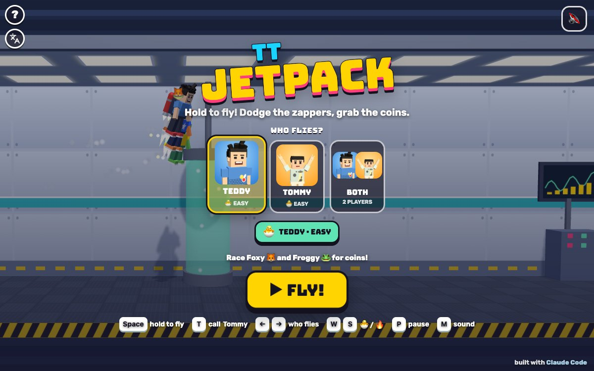

# TT Jetpack

Press **?** any time (or tap the round **?** button in the top left corner) to see the keys. The game waits while you look.
Tap the language button under it (the A文 icon) to switch between English and 中文; the dashboard and every game remember the choice.

**中文：** 喷气背包：按住就往上飞，松开就往下掉。在实验室里一路躲开电网、抓金币，飞到出口。和狐狸、青蛙比赛谁的金币多，或者兄弟俩一起飞。叫兄弟来，他会带来好吃的，还有一个电网电不到你的护盾。

A jetpack game for Teddy and Tommy. Hold to fly through a long science lab, let go to drop, dodge the crackling zappers (some of them spin) and grab the coins all the way to the EXIT door. In 1 player you race Foxy 🦊 and Froggy 🐸 for coins (each of them collects their own, so they never take yours); with 2 players the brothers race each other on one screen. Whoever has the most coins at the exit stands on top of the podium and does his signature move. Two levels, and the other brother always ready to fly in with a treat and a shield.

It's built with Claude Code from plain JavaScript and Three.js, in the same style as Metro Surfer and the other Teddy & Tommy games. There are no image, model or audio files: the lab, the zappers and the coins are boxes, cylinders and canvas textures, Teddy and Tommy come from the shared kit (`kit/`), and every sound is synthesised.

The name lives in one place, [js/title.js](js/title.js).

## Play

- **Double-click `index.html`.** It works offline, because Three.js and the kit are copied into `kit/`. Without internet the logo falls back from the Bungee font to Arial Black.
- **Send one file:** `dist/jetpack-tt.html` is the whole game in one file. AirDrop or email it, then open it in a browser.
- **Rebuild that file** after any edit: `python3 kit/tools/bundle.py . --name jetpack-tt`
- **Get kit updates** from `~/claude-games/kit`: `python3 ../kit/tools/sync.py .`, then rebuild.
- **On the home screen** pick who flies (TEDDY, TOMMY or BOTH) and 🐣 EASY or 🔥 NORMAL for each brother, then ▶ FLY!. Behind the menu a demo flight goes through a lab, again and again.
- **Each flight** starts with 3, 2, 1, GO! on the lab floor. Hold to fly; the bar at the top shows how far it is to the 🚪 exit.
- **The end:** at the exit everyone flies down onto the podium, 1st, 2nd and 3rd by coins. The winner does his signature move (Teddy's boxing combo, then his 🏀 jump shot; Tommy's Y with peace fingers ✌️; Foxy and Froggy wave) while confetti flies, then the results: 🥇 🥈 🥉 with everyone's coins, each brother's best, NEW BEST! when he beats it. ↻ PLAY AGAIN flies a new lab, 🏠 HOME goes back.
- **Saved per browser:** who flies, each brother's level, and each brother's best coins on each level. `index.html` and `dist/jetpack-tt.html` each keep their own, because they're different ways of opening the game.

### The lab

- **Every flight is a new lab**, made from a random seed by [js/lab.js](js/lab.js): first a safe line through the lab that a jetpack can always follow, then zappers placed only where they stay well clear of that line, then rows of coins along it and a little off it, where you have to steer to get them (and a few bonus blocks in the open).
- **Zappers:** two emitter rods and a crackling beam across the whole depth of the corridor. Standing gates, hanging gates, gate pairs with a gap, flat bars, slanted ones, and on NORMAL, spinners.
- **Before you fly it, the game flies it:** a solver tries every hold / let-go choice, every 0.1 s, with the game's own physics, and the lab is only used once it finds a way to the exit (see "How it was checked").
- Along the walls: windows onto a night city, lab benches with glowing flasks, bubbling tanks, screens with charts, pipes and ⚡ signs. At the exit: a green door, a checkered line, balloons and the podium.

### Levels

| | 🐣 EASY (Tommy, 5) | 🔥 NORMAL (Teddy, 8) |
|---|---|---|
| Lab | 420 m at 5 to 5.6 m/s (about 80 s) | 720 m at 7.5 to 10 m/s (about 80 s) |
| Jetpack | gentle: floor to ceiling in 1.3 s, top speed 5.2 up, 5.6 down | snappy: floor to ceiling in 0.9 s, 8 up, 9.5 down |
| Room round the safe line | 1.8 m to the nearest beam | 1.4 m, and spinners |
| A zap | a dizzy shake, drop up to 3 coins, then 2.2 s of blinking safety | lose a ❤️ (3 of them) and up to 5 coins; no hearts left and you're out |
| Foxy and Froggy | wobbly and slow to react: Tommy wins most races | quicker: a careful Teddy wins some races and loses some |

With 2 players, each brother flies with his own level's jetpack and hearts, in a lab made for the easier of the two. A brother who runs out of hearts floats along to the exit in a bubble and keeps his coins; the flight only ends early if both are out. In 1 player on NORMAL, running out of hearts ends the flight: ⚡ ZAPPED!

### Fair coins

- **Your coins are yours.** In 1 player, Foxy and Froggy each collect their own copy of the lab's coins. The coins you see are yours: they only disappear when you touch them, never because Foxy or Froggy flew through first. When they grab one of theirs you see a little sparkle on them and their counter goes up.
- **Touch it on screen and it's yours; miss it on screen and you miss it.** A coin counts as touched when its disc touches your body as it's drawn (from the jetpack on your back to your hands, from your feet to your hair), and your coins are drawn in the same plane you fly in, so there's no gap between where a coin looks and where it is.
- **Nobody looks ahead.** Everyone flies at the same speed, so everyone is always at the same distance along the lab. The camera stands right beside the flyers and looks straight across the lab, and Foxy and Froggy (who fly further back, behind your coins) are drawn on the camera's line of sight through their place, so two flyers level with each other look level on screen, in both directions. When Foxy or Froggy is right behind you, their little faces (🦊 🐸) show over your head so you know where they are.
- **Two brothers** share one set of coins, drawn in the plane they both fly in: whoever touches a coin first gets it. If both touch it at the same moment it goes to the one it's further into, and an exact tie to whoever has fewer coins.
- The first version had all three flyers racing for the same coins, drawn at Foxy's depth, so on screen the rivals looked a little ahead and took coins that seemed to be touching you. That's what Alan saw, and what `tools/fair.js` was written to catch (see below).

## Controls

| | 1 player | Teddy (2 players) | Tommy (2 players) |
|---|---|---|---|
| Fly (hold) | Space, W, ↑ or Enter | W or Space | ↑ or Enter |
| Call your brother · high five | T | T | T |
| Pause | P or Esc | | |
| Sound on / off | M | | |

- **Home screen:** ← → pick who flies, 1 2 3 pick Teddy, Tommy or both, W S change Teddy's level and ↑ ↓ Tommy's (in 1 player both change the one who flies), Enter or Space flies. On the results, Enter flies again, Esc or H goes home.
- **Touch:** hold anywhere to fly. With 2 players, Teddy holds the left half of the screen and Tommy the right half. Tap your brother's face (or ✋ with two players) in the bottom left corner.
- **The ? panel, the language button and the speaker** sit in a column in the top left corner, over the part of the lab you've already flown through. The coin counters sit above the ceiling, and the camera keeps the whole lab between them and the buttons at the bottom.

## Companion

- **Call your brother any time, as often as you like:** press T or tap his face in the bottom left corner (Kit.roster.buddyFor picks him: Tommy for Teddy, Teddy for Tommy).
- He flies in on his own jetpack at his buddy size and does his signature move in mid-air: Tommy's Y ✌️, or Teddy's boxing.
- He tosses you a treat (🍦 💧 🧃 🍪 🍉 🍌): "🍪 COOKIE FROM TOMMY!" On NORMAL it gives back a ❤️ if you've lost one.
- Then his helper: **"TOMMY SAYS: SHIELD!"** A bubble shield goes round you for 8 seconds and zappers bounce off it (🛡️ SHIELD BLOCK!). He flies along just behind you while it lasts, then does his goodbye move and zooms off. Call him again and he does it all again, shield and all.
- **With two players,** T (or the ✋ button) is a high five: both brothers hold out a hand.

## How it was checked

- **`node tools/check.js`** (about 20 seconds), the same checks as `game.check()` in the page (quicker, fewer labs; [js/checks.js](js/checks.js)):
  - **passable** (the generator is always passable): 10 EASY labs and 10 NORMAL labs, each flown to the exit by the solver with the game's own physics step and collision test, plus every EASY lab flown with NORMAL physics (Teddy on NORMAL with Tommy on EASY) and with 0.3 m of extra wobble room. The quicker check the game runs before each flight agrees on every one. Then the solver's own inputs are flown through the real game: 30 whole flights, 0 zaps, exit reached every time.
  - **layout:** every zapper stays clear of the safe line (EASY 1.79 m, NORMAL 1.39 m) and inside the lab, every coin is at least 0.83 m from a beam, the same seed always makes the same lab, and every lab has plenty of zappers and coins.
  - **bounds** (physics): 3 minutes of random jetting on each level never leaves the lab or goes past the top speeds.
  - **frames** (physics): 40 seconds with Foxy and Froggy at 30, 60, 144 and a jumpy frame rate come out exactly the same (fixed 1/120 s steps).
  - **feel** (physics): floor to ceiling and back in the times in the table above, and EASY climbs and falls more gently than NORMAL.
  - **zaps:** a flyer 1 cm inside a beam or an orb is hit and 1 cm outside isn't, spinners are where their turn says, EASY never knocks you out, NORMAL does after 3 zaps, the shield blocks.
  - **coins:** a coin 2 cm inside the edge of the drawn body (above the hair, below the feet) is collected and 2 cm outside isn't; with Foxy and Froggy flying exactly the human's line he still gets every coin he gets alone (436 over 3 labs) and they get their own (872 between them); two brothers on the very same line share the coins (146 / 147); two equally good brothers each win their share (4 and 5 of 8 races).
  - **easyRace:** on EASY a pretend wobbly 5-year-old beats Foxy and Froggy in 12 of 12 races (about 217 coins to their 155), and a sloppier one (slow to react, only goes for coins now and then) in 11 of 12.
  - **normalRace:** on NORMAL a pretend careful 8-year-old beats them sometimes: 7 of 12 races (most losses are running out of hearts; the brother's shield helps there).
  - **Each check is broken on purpose** and has to notice: a zapper from floor to ceiling, gates too narrow to fly through, a jetpack too weak to lift you (all three: "no way through"), a coin inside a zapper, no floor, ceiling or top speed, one physics step per frame, EASY flying like NORMAL, a shield that does nothing, Foxy and Froggy racing for the human's coins (the first version), and Foxy and Froggy never missing a coin (on EASY and on NORMAL). All eleven are caught.
- **`node tools/fair.js`** (about 3 minutes, headless Chrome, muted): fairness in the real page, flying with real keydown / keyup events on window (Space for 1 player, W and ↑ for two), steering every 0.1 s by the coins drawn on screen ([tools/fair-checks.js](tools/fair-checks.js)):
  - **touch:** every coin that touched the human's body on screen (by 8 px or more, both projected with the game's own camera) was his, and every coin he got had touched him on screen (within 8 px): 99 touched, 106 collected, 12 clear misses not collected.
  - **rivals:** no coin ever disappeared from the human's screen unless he took it, and Foxy and Froggy took none of his (while collecting 29 + 41 and 18 + 38 of their own).
  - **level:** everyone at the same x shows at the same x on screen, and every flyer shows at his true height: 0.0 px off.
  - **twoPlayers:** the same with W and ↑ at once: 67 coins touched, 70 collected, every one by a brother it touched on screen.
  - **keysRace:** whole races with keys: a slow, wobbly pretend 5-year-old won 3 of 3 on EASY; a careful pretend 8-year-old (who steers round zappers) won 2 of 4 on NORMAL.
  - **On the first version** (commit ffe69ad, opened from file:// with `URL=...`) the same checks fail: coins touching Teddy by 70 px on screen went to Froggy and Foxy, 59 of his coins vanished into the rivals, rivals at the same x showed 35 px ahead (and 38 px off in height), and in 2 players coins touching a brother by 22 px went to nobody.
- **In the browser** (muted): flights at both levels, 1 player and 2, keys and touch (synthetic keyboard and pointer events, both halves of the screen), the brother's visit (signature move, treat, shield, a zap blocked by it, a bare pass zapped), high fives, pause, the ? panel, running out of hearts, the podium and the results, through `game.step()`. 中文: every screen visited with `Kit.lang.untranslated()` returning [], and the toasts read one by one. English: no Chinese on the page except the kit's language button. No console errors. `game.check()` and `game.prove()` pass in the page.
- **Layouts** in headless Chrome (`node tools/shoot.js tools/shots-layout.json <dir> <width> <height> <mobile>`): phone portrait 390x844, phone landscape 740x360, iPad 1024x768 and 820x1180. `docs/screenshot.jpg` is the title screen at 1200x750 (`node tools/shoot.js tools/shots.json docs 1200 750`). `tools/shots-tour.json` visits every screen.

## Files

- [index.html](index.html): the page, its styles and the menus.
- [js/title.js](js/title.js): the name.
- [js/lab.js](js/lab.js): the rules with no drawing: the jetpack physics, the lab generator, the solver, zaps, coins, hearts, the shield, Foxy and Froggy, the pretend players.
- [js/checks.js](js/checks.js), [tools/check.js](tools/check.js): the headless checks.
- [js/world.js](js/world.js): the 3D lab, the zappers, coins, props, the exit and podium, sparks, smoke and confetti.
- [js/flyer.js](js/flyer.js): the flyers (the kit's boys with jetpacks, Foxy and Froggy), their poses, zaps, bubbles and celebrations.
- [js/game.js](js/game.js): the game: home, count-in, controls, camera, the brother's visit, high fives, the HUD, the podium, results.
- [js/keys.js](js/keys.js), [js/zh.js](js/zh.js): the ? panel and the 中文 words.
- [tools/shoot.js](tools/shoot.js): screenshots with headless Chrome.
- [tools/fair.js](tools/fair.js), [tools/fair-checks.js](tools/fair-checks.js): the fairness checks in the real page, flying with keys.

## Not verified

- **Sound:** every test ran muted, so none of it has been heard; the sounds are checked in code only.
- **Real touch devices:** an iPhone or iPad, iOS Safari, two kids holding both halves of one iPad at once, and the frame rate on an older iPad. The game builds each new lab and flies it before you play it: the pause after ▶ FLY! is 0.2 to 0.6 s on this Mac, and may be longer on an older iPad.
- **Real kids:** whether EASY is easy enough for Tommy, whether NORMAL is a good race for Teddy, and whether 80 seconds is too long. The win rates above come from pretend players; with 2 players the brothers race for the same coins, so when Teddy flies much more accurately than Tommy he'll usually win (two equally good players win about evenly).
- **The iPad home-screen icon** (⚡ on lab blue) and double-click from Finder.
- **Kit:** after switching 中文 → English with the ? panel closed, the hidden panel keeps its Chinese until it's opened again (kit behaviour, not changed here).
